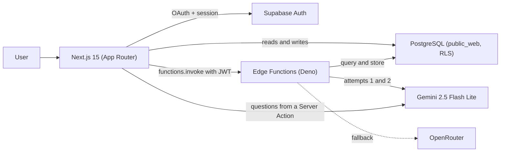
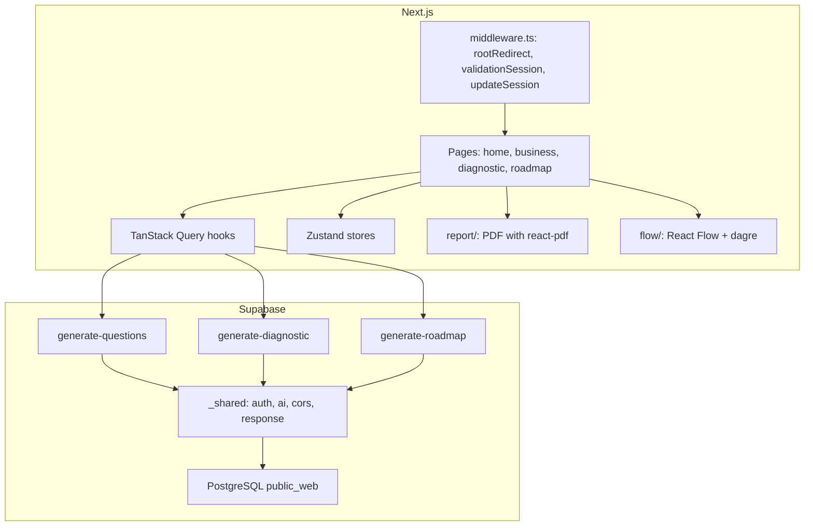
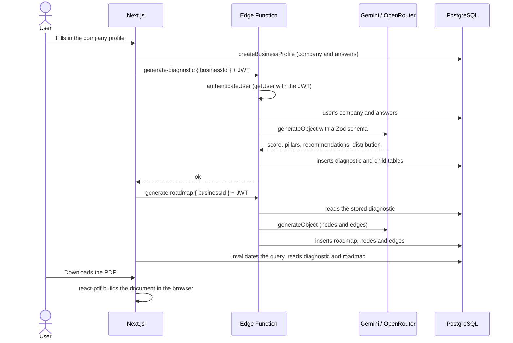

# ReadIA architecture

English · [Español](./architecture.md)

ReadIA keeps the interface apart from AI orchestration. Next.js serves the UI and holds the session; generation with language models runs in Supabase Edge Functions (Deno) that authenticate with the user's JWT and write results to PostgreSQL under RLS.

## Context



## Components



## Main flow: from questionnaire to report



## Data flow

1. The company profile and answers are stored in `public_web` (`businesses`, `questions`, `responses`).
2. `generate-diagnostic` reads the company and answers, asks for an object validated with Zod and splits it across `diagnostics`, `diagnostic_pillars`, `diagnostic_pillar_data`, `diagnostic_distributions` and `diagnostic_recommendations`.
3. `generate-roadmap` starts from the stored diagnostic and writes `roadmaps`, `roadmap_nodes` and `roadmap_edges`.
4. The client reads those tables with TanStack Query and refetches when the `["diagnostic", id]` or `["roadmap", id]` key is invalidated.
5. The PDF is composed in the browser from the data already in memory.

The diagnostic-then-roadmap order is driven by `triggerSequentialGeneration` in `src/hooks/use-create-business-profile.ts`, which also keeps the state (`diagnostic`, `roadmap`, `completed`, `failed_*`) in a Zustand store. If a stage fails, the UI offers to regenerate it by hand.

## Folder structure

```text
src/
  app/
    (main)/            home, business, diagnostic, roadmap, dashboard
    actions/           Server Actions (company profile, roadmap)
    auth/callback/     OAuth code to session exchange
    login/
  components/
    landing-page/      public site
    forms/company-profile/   form steps, Zod schemas, question carousel
    diagnostic/        radar, distribution, score, recommendations
    flow/              roadmap nodes and panels
    sidebar/           company switcher and navigation
    ui/                shadcn components
  hooks/               queries and Edge Function triggers
  stores/              Zustand: business, form, diagnostic, roadmap, generation
  report/              DiagnosticReport and its sections
  utils/supabase/      browser, server and middleware clients
supabase/
  functions/_shared/   auth, ai (fallback chain), cors, response, client
  functions/<name>/    generate-questions, generate-diagnostic, generate-roadmap
  migrations/          schema, RLS and base questions
```

## Key decisions

- **AI in Edge Functions, not in Next.js.** The three functions share authentication, CORS, response format and the model chain in `_shared`. The UI only calls `functions.invoke`. One exception: question generation for the profile also has a Next.js Server Action that calls Gemini.
- **Structured output with Zod.** Each function defines the expected schema and uses the AI SDK's `generateObject`. If the model returns something invalid, the attempt counts as failed and the fallback kicks in.
- **Cross-provider fallback.** `_shared/ai.ts` tries Gemini twice (`gemini-2.5-flash-lite`), then OpenRouter (`openrouter/free`) twice. The response includes the model used and the attempts log.
- **Per-user authorization.** The functions validate the JWT with `getUser` and query the company filtered by `user_owner_id`. If it does not belong to the user, they answer 404. The database backs this up with RLS.
- **Dedicated schema.** Tables live in `public_web`, and the migrations, RLS policies included, are versioned in `supabase/migrations`. TypeScript types are generated with `pnpm gen:types`.
- **Chained middleware.** `middleware.ts` runs `rootRedirect`, `validationSession` and `updateSession` in that order; the first one that returns a response ends the chain.
- **PDF on the client.** `@react-pdf/renderer` builds the report in the browser, with no extra service.
- **Roadmap as a graph.** Nodes and edges are stored with a position; `dagre` computes the layout and React Flow draws it.

## Pending

- Persist node and subtask status (simulated today in `src/app/actions/roadmap-actions.ts`).
- Automated tests and CI.
