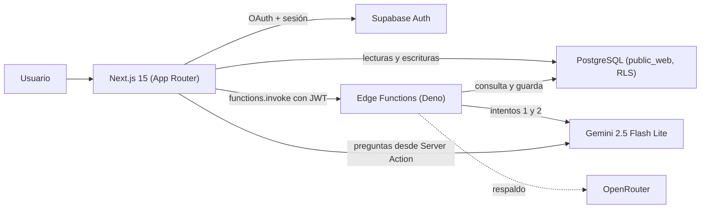
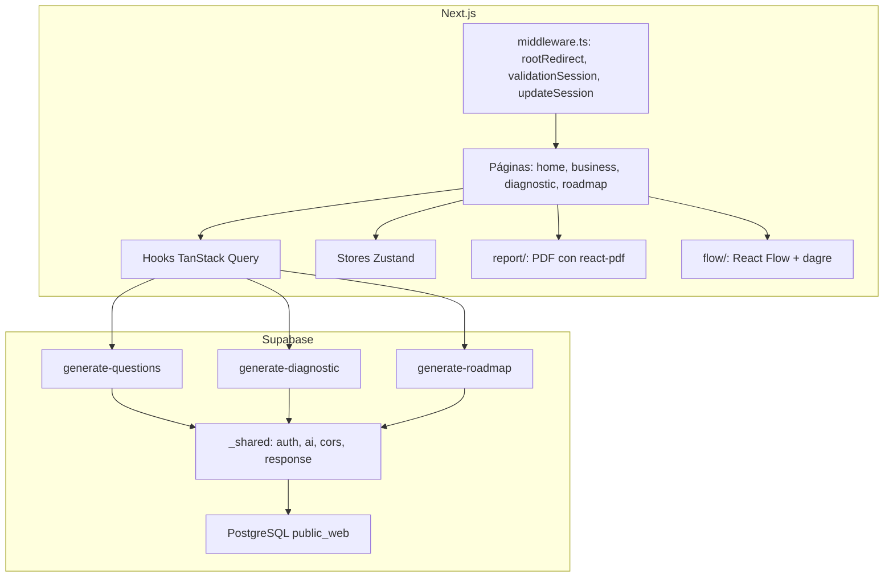
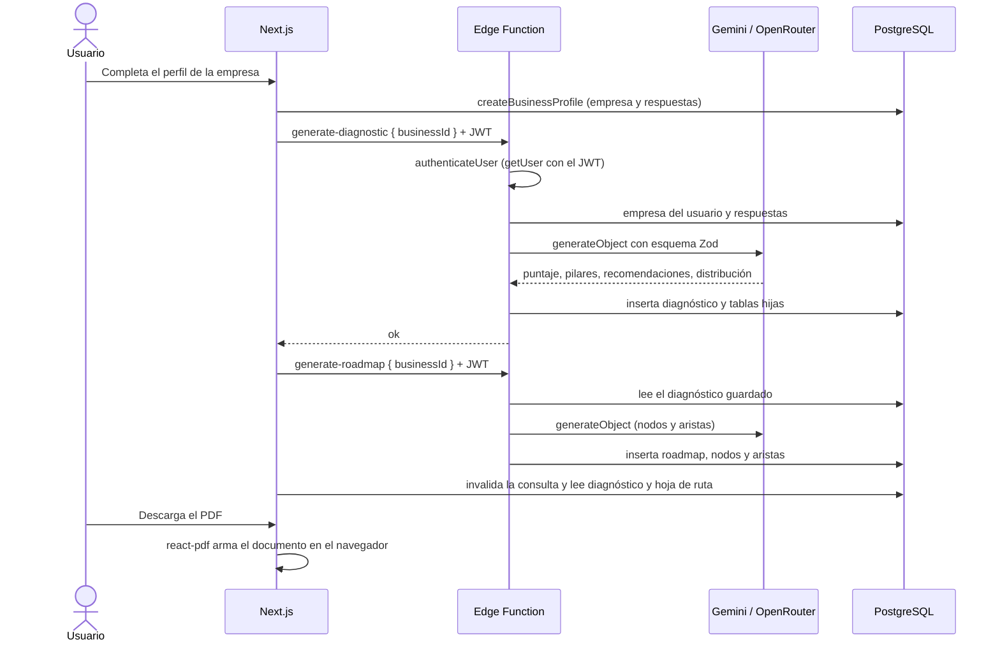

# Arquitectura de ReadIA

[English](./architecture.en.md) · Español

ReadIA separa la interfaz de la orquestación de IA. Next.js sirve la UI y mantiene la sesión; la generación con modelos de lenguaje ocurre en funciones Edge de Supabase (Deno) que se autentican con el JWT del usuario y escriben el resultado en PostgreSQL bajo RLS.

## Contexto



## Componentes



## Flujo principal: del cuestionario al informe



## Flujo de datos

1. El perfil de la empresa y las respuestas se guardan en `public_web` (`businesses`, `questions`, `responses`).
2. `generate-diagnostic` lee empresa y respuestas, pide un objeto validado con Zod y lo reparte en `diagnostics`, `diagnostic_pillars`, `diagnostic_pillar_data`, `diagnostic_distributions` y `diagnostic_recommendations`.
3. `generate-roadmap` parte del diagnóstico guardado y escribe `roadmaps`, `roadmap_nodes` y `roadmap_edges`.
4. El cliente lee esas tablas con TanStack Query y las vuelve a pedir cuando invalida la clave `["diagnostic", id]` o `["roadmap", id]`.
5. El PDF se compone en el navegador con los mismos datos que ya están en memoria.

El orden diagnóstico y luego hoja de ruta lo controla `triggerSequentialGeneration` en `src/hooks/use-create-business-profile.ts`, que además guarda el estado (`diagnostic`, `roadmap`, `completed`, `failed_*`) en un store de Zustand. Si una etapa falla, la UI ofrece regenerarla a mano.

## Estructura de carpetas

```text
src/
  app/
    (main)/            home, business, diagnostic, roadmap, dashboard
    actions/           Server Actions (perfil de empresa, roadmap)
    auth/callback/     intercambio del código OAuth por sesión
    login/
  components/
    landing-page/      sitio público
    forms/company-profile/   pasos del formulario, esquemas Zod, carrusel de preguntas
    diagnostic/        radar, distribución, puntaje, recomendaciones
    flow/              nodos y paneles de la hoja de ruta
    sidebar/           selector de empresa y navegación
    ui/                componentes shadcn
  hooks/               consultas y disparo de funciones Edge
  stores/              Zustand: empresa, formulario, diagnóstico, roadmap, generación
  report/              DiagnosticReport y sus secciones
  utils/supabase/      cliente browser, server y middleware
supabase/
  functions/_shared/   auth, ai (cadena de respaldo), cors, response, cliente
  functions/<nombre>/  generate-questions, generate-diagnostic, generate-roadmap
  migrations/          esquema, RLS y preguntas base
```

## Decisiones clave

- **IA en funciones Edge, no en Next.js.** Las tres funciones comparten autenticación, CORS, formato de respuesta y la cadena de modelos en `_shared`. La UI solo llama a `functions.invoke`. Una excepción: la generación de preguntas del perfil también tiene una Server Action en Next.js que llama a Gemini.
- **Salida estructurada con Zod.** Cada función define el esquema esperado y usa `generateObject` del AI SDK. Si el modelo devuelve algo inválido, el intento cuenta como fallido y entra el respaldo.
- **Respaldo entre proveedores.** `_shared/ai.ts` intenta Gemini dos veces (`gemini-2.5-flash-lite`) y después OpenRouter (`openrouter/free`) dos veces. La respuesta incluye el modelo usado y el registro de intentos.
- **Autorización por usuario.** Las funciones validan el JWT con `getUser` y consultan la empresa filtrando por `user_owner_id`. Si no es del usuario, responden 404. La base refuerza esto con RLS.
- **Esquema aparte.** Las tablas viven en `public_web` y las migraciones, incluidas las políticas de RLS, están versionadas en `supabase/migrations`. Los tipos de TypeScript se generan con `pnpm gen:types`.
- **Middleware en cadena.** `middleware.ts` ejecuta `rootRedirect`, `validationSession` y `updateSession` en ese orden; el primero que devuelve una respuesta corta la cadena.
- **PDF en el cliente.** `@react-pdf/renderer` genera el informe en el navegador, sin servicio adicional.
- **Hoja de ruta como grafo.** Los nodos y aristas se guardan con posición; `dagre` calcula el diseño y React Flow lo dibuja.

## Pendiente

- Persistir el estado de nodos y subtareas (hoy simulado en `src/app/actions/roadmap-actions.ts`).
- Pruebas automatizadas y CI.
